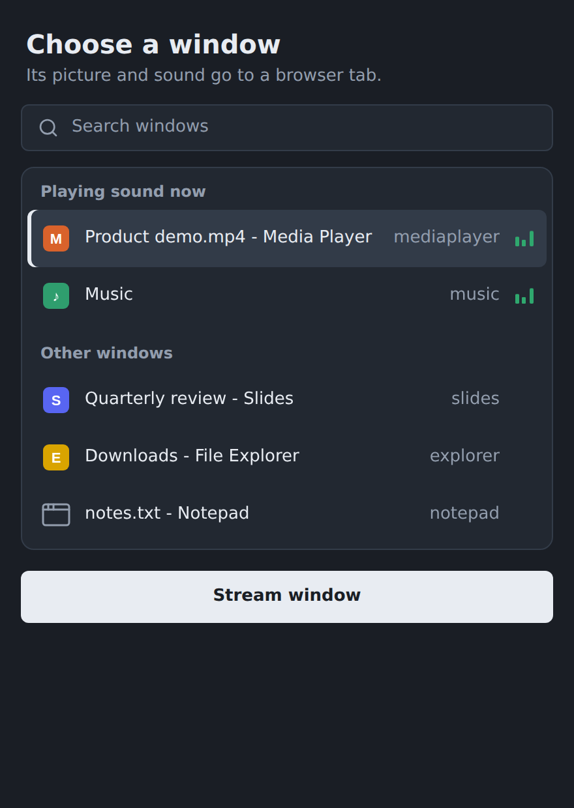
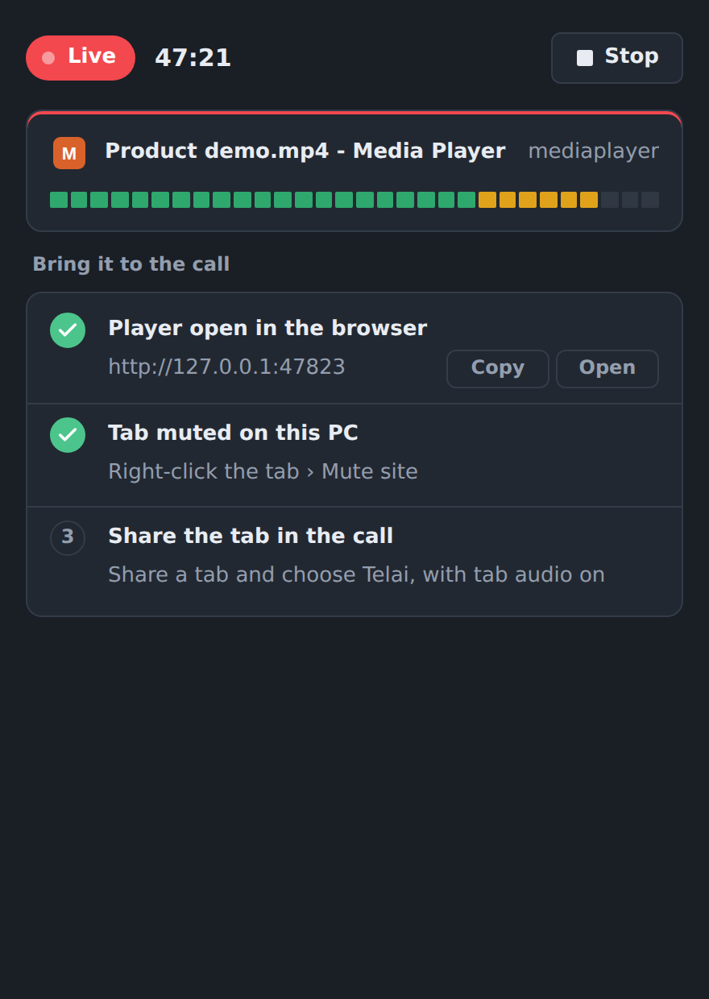
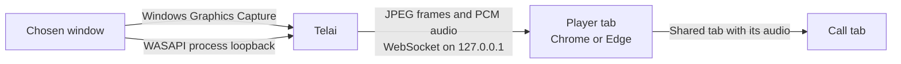

# Telai

[Português](README.pt-BR.md)

Telai streams one desktop window, with only that program's sound, to a tab in the browser. The tab can then be shared in any browser call that shares tabs.

<p>
  
  
</p>

## The problem

Browser calls share audio in two ways: the audio of one tab, or the audio of the whole system. A desktop program has no tab, and the system audio also carries everything else on the PC: notifications, other programs and any voice chat running at the same time.

Telai captures the picture of one window and the audio of its process tree only. It plays both in a local page at `http://127.0.0.1:47823`. Sharing that tab in the call sends the program's picture and sound, and nothing else.

## How it works



- **Video**: Windows Graphics Capture delivers the window at up to 30 fps. Two encoder threads turn each frame into a JPEG, scaled down to 1080p when larger. A frame that arrives while both threads are busy is dropped, so a slow machine loses frames instead of adding delay.
- **Audio**: WASAPI process loopback records the audio rendered by the window's process and its children, as 48 kHz stereo `f32` samples. It requires Windows 10 version 2004 or later.
- **Player**: the page decodes frames with `createImageBitmap` onto a canvas and plays audio through an `AudioWorklet` with a 40 ms jitter buffer, capped at 150 ms.

## Duplicate sound

The player tab plays the audio aloud, and the program plays it too. Muting the player tab in the browser (right-click the tab, then **Mute site**) silences only the local playback: Chromium keeps delivering the tab audio to the tab capture. Chrome stores this setting per site, so it is done once.

Telai checks which browser process holds the player connection and whether that process plays sound. While it does, the app asks for the tab to be muted.

## Usage

1. Run Telai and choose the window. Windows playing sound are listed first.
2. Open the player in Chrome or Edge with **Open**, and click the page once to allow sound.
3. Mute the player tab: right-click the tab, then **Mute site**.
4. In the call, share a tab and choose the Telai tab, with tab audio on.

Closing the window while streaming keeps Telai in the notification area. Closing the captured window ends the stream.

## Requirements

- Windows 10 version 2004 or later, or Windows 11.
- Chrome or Edge to share the player tab. Firefox does not share tab audio.

## Building from source

Prerequisites: [Rust](https://rustup.rs) (stable), [Node.js](https://nodejs.org) 24 and [pnpm](https://pnpm.io).

```sh
pnpm install
pnpm tauri dev      # run in development
pnpm tauri build    # build the installer in target/release/bundle/nsis
```

Development builds serve the player from `dist/`, so `pnpm build` runs once before `pnpm tauri dev`.

Checks:

```sh
pnpm lint && pnpm typecheck && pnpm test
cargo clippy --workspace --all-targets
cargo test --workspace
```

The `telai-stream` crate and the frontend build and test on any platform. The capture crate and the app build on Windows only.

`cargo test --workspace -- --include-ignored` also runs a live capture test on Windows. It opens a window that plays a tone, then checks the window list, one captured frame and the captured audio. It needs a desktop session and an audio output device.

## Project layout

| Path             | Contents                                                               |
| ---------------- | ---------------------------------------------------------------------- |
| `crates/capture` | Window list, window capture, process audio capture, audio sessions     |
| `crates/stream`  | JPEG encoding, wire protocol, HTTP and WebSocket server for the player |
| `src-tauri`      | Tauri app: live session, commands, tray icon                           |
| `src/app`        | App window (React)                                                     |
| `src/player`     | Player page                                                            |
| `src/shared`     | Wire protocol shared by the page and `crates/stream/src/protocol.rs`   |

## Security

The server listens on `127.0.0.1` only. It rejects requests whose `Host` header names another host, which blocks DNS rebinding, and WebSocket handshakes from any other origin, so no website can open the stream.

## License

[MIT](LICENSE)
