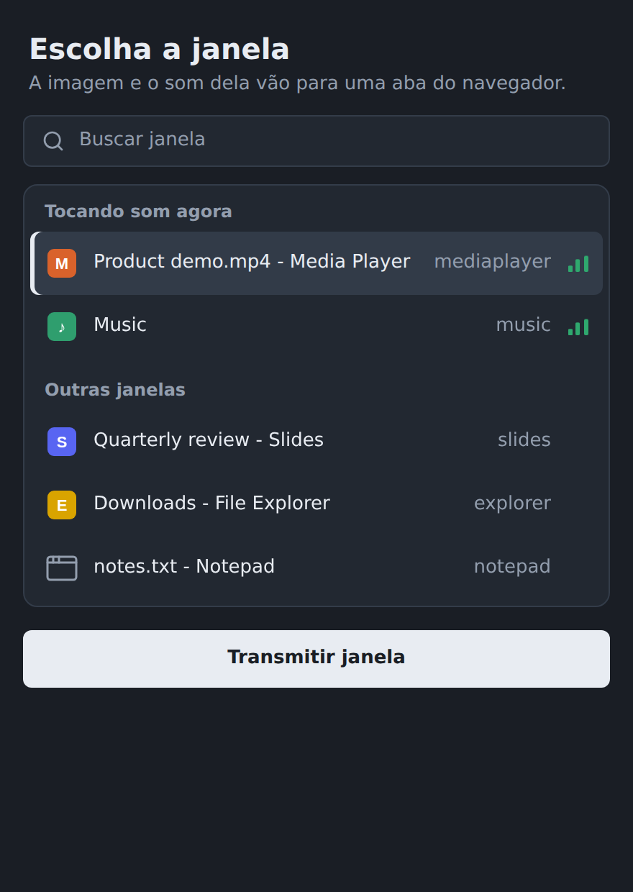
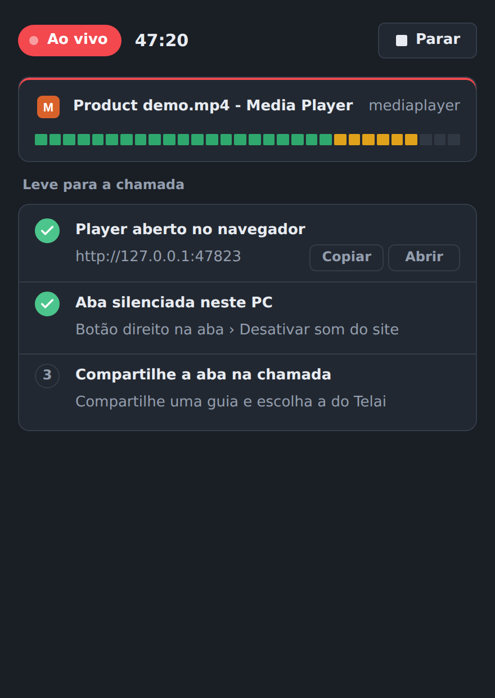

# Telai

[English](README.md)

O Telai transmite uma janela do computador, com o som apenas daquele programa, para uma aba do navegador. Essa aba pode ser compartilhada no Jitsi Meet, no Google Meet ou em qualquer chamada que compartilhe abas.

<p>
  
  
</p>

## O problema

Chamadas no navegador compartilham áudio de duas formas: o áudio de uma aba ou o áudio do sistema inteiro. Um player de desktop como o VLC ou o Stremio não tem aba. O áudio do sistema leva junto todo o resto do PC, incluindo as vozes de uma chamada do Discord em andamento.

O Telai captura a imagem de uma janela e somente o áudio da árvore de processos dela. Ele toca os dois em uma página local, em `http://127.0.0.1:47823`. Compartilhar essa aba na chamada envia a imagem e o som do programa, e nada além disso.

## Funcionamento

```mermaid
flowchart LR
  window["Janela escolhida<br/>(VLC, Stremio, ...)"]
  app["Telai"]
  tab["Aba do player<br/>Chrome ou Edge"]
  call["Aba da chamada<br/>Jitsi Meet"]

  window -- "Windows Graphics Capture" --> app
  window -- "WASAPI process loopback" --> app
  app -- "Quadros JPEG e áudio PCM<br/>WebSocket em 127.0.0.1" --> tab
  tab -- "Compartilhar guia, com o áudio da guia" --> call
```

- **Vídeo**: o Windows Graphics Capture entrega a janela a até 30 fps. Duas threads de codificação convertem cada quadro em JPEG, reduzido para 1080p quando maior. Um quadro que chega com as duas threads ocupadas é descartado: em uma máquina lenta, a transmissão perde quadros em vez de acumular atraso.
- **Áudio**: o WASAPI process loopback grava o áudio tocado pelo processo da janela e pelos processos filhos, em estéreo `f32` a 48 kHz. Exige o Windows 10 versão 2004 ou mais novo.
- **Player**: a página decodifica os quadros com `createImageBitmap` em um canvas e toca o áudio por um `AudioWorklet` com buffer de 40 ms, limitado a 150 ms.

## Som duplicado

A aba do player toca o áudio em voz alta, e o programa também toca. Desativar o som da aba no navegador (botão direito na aba, depois **Desativar som do site**) silencia apenas a reprodução local: o Chromium continua entregando o áudio da aba para a captura de aba. O Chrome guarda essa configuração por site, então o passo é feito uma única vez.

O Telai identifica o processo do navegador dono da conexão do player e verifica se esse processo toca som. Enquanto toca, o app pede para silenciar a aba.

## Uso

1. Abra o Telai e escolha a janela. As janelas que tocam som aparecem primeiro.
2. Abra o player no Chrome ou no Edge com **Abrir** e clique uma vez na página para liberar o som.
3. Silencie a aba do player: botão direito na aba, depois **Desativar som do site**.
4. No Jitsi, escolha **Compartilhar tela**, depois **Guia do Chrome**, depois a aba do Telai.

Fechar a janela do Telai durante a transmissão mantém o app na área de notificação. Fechar a janela capturada encerra a transmissão.

## Requisitos

- Windows 10 versão 2004 ou mais novo, ou Windows 11.
- Chrome ou Edge para compartilhar a aba do player. O Firefox não compartilha o áudio de abas.

## Compilação

Pré-requisitos: [Rust](https://rustup.rs) (stable), [Node.js](https://nodejs.org) 24 e [pnpm](https://pnpm.io).

```sh
pnpm install
pnpm tauri dev      # executa em desenvolvimento
pnpm tauri build    # gera o instalador em target/release/bundle/nsis
```

Builds de desenvolvimento servem o player a partir de `dist/`, então `pnpm build` roda uma vez antes de `pnpm tauri dev`.

Verificações:

```sh
pnpm lint && pnpm typecheck && pnpm test
cargo clippy --workspace --all-targets
cargo test --workspace
```

O crate `telai-stream` e o frontend compilam e rodam os testes em qualquer plataforma. O crate de captura e o app compilam apenas no Windows.

No Windows, `cargo test --workspace -- --include-ignored` também roda um teste de captura real. Ele abre uma janela que toca um tom e verifica a lista de janelas, um quadro capturado e o áudio capturado. O teste exige uma sessão de desktop e um dispositivo de saída de áudio.

## Estrutura

| Caminho          | Conteúdo                                                                 |
| ---------------- | ------------------------------------------------------------------------ |
| `crates/capture` | Lista de janelas, captura de janela, captura de áudio do processo        |
| `crates/stream`  | Codificação JPEG, protocolo, servidor HTTP e WebSocket do player         |
| `src-tauri`      | App Tauri: sessão ao vivo, comandos, ícone na bandeja                    |
| `src/app`        | Janela do app (React)                                                    |
| `src/player`     | Página do player                                                         |
| `src/shared`     | Protocolo compartilhado entre a página e `crates/stream/src/protocol.rs` |

## Segurança

O servidor escuta apenas em `127.0.0.1`. Ele recusa requisições cujo cabeçalho `Host` aponta para outro host, o que bloqueia DNS rebinding. Também recusa handshakes de WebSocket de qualquer outra origem, então nenhum site consegue abrir a transmissão.

## Licença

[MIT](LICENSE)
