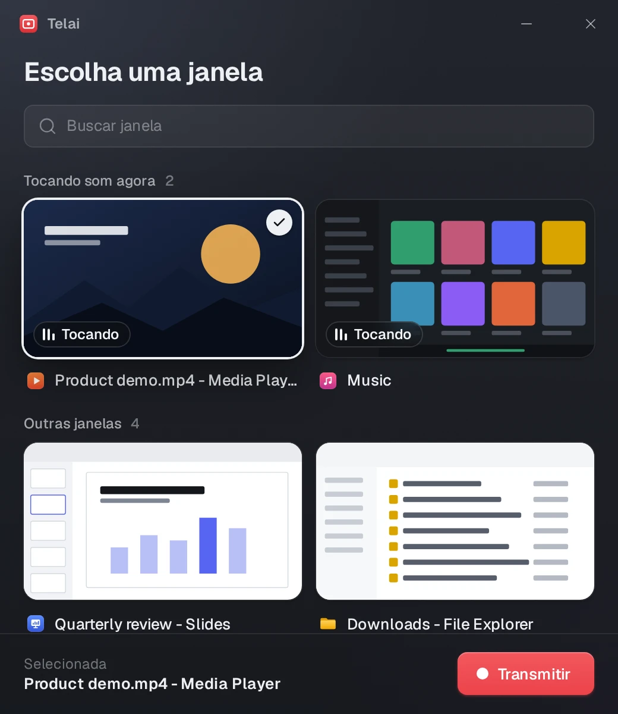
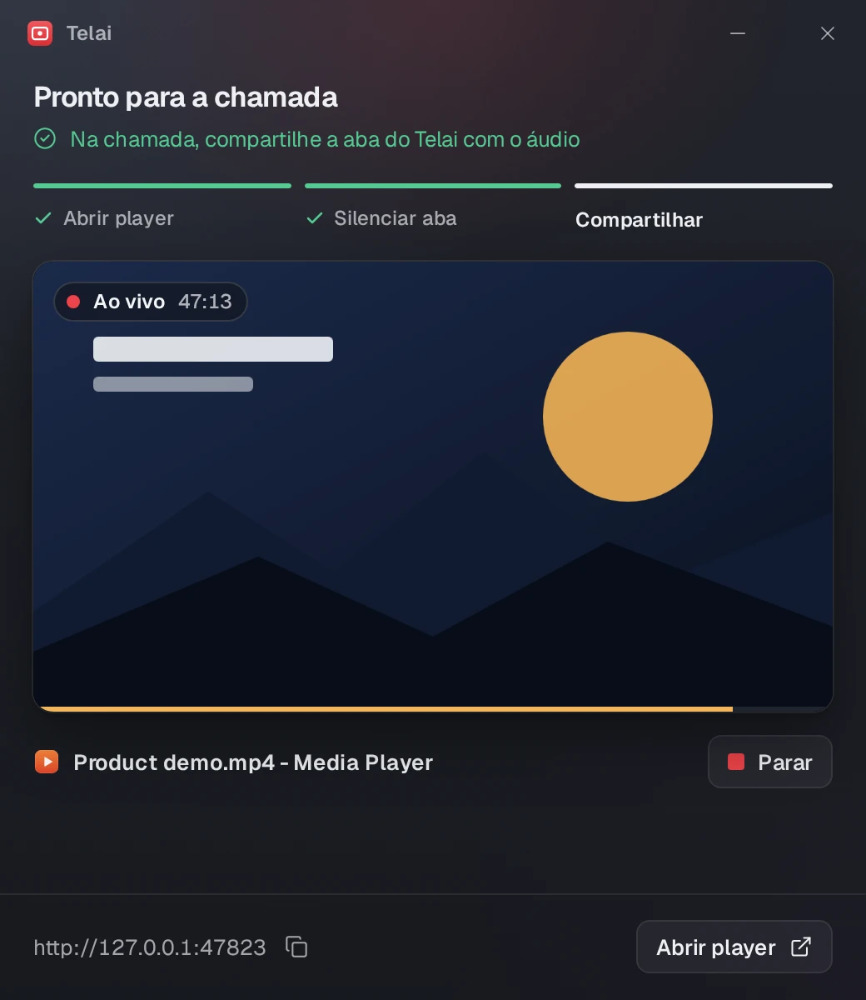
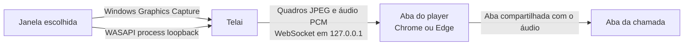

# Telai

[English](README.md)

O Telai transmite uma janela do computador, com o som apenas daquele programa, ou uma tela inteira, com o som apenas dos apps que você escolher, para uma aba do navegador. Essa aba pode ser compartilhada em qualquer chamada no navegador que compartilhe abas.

<p>
  
  
</p>

## O problema

Chamadas no navegador compartilham áudio de duas formas: o áudio de uma aba ou o áudio do sistema inteiro. Um programa de desktop não tem aba. O áudio do sistema leva junto todo o resto do PC: notificações, outros programas e qualquer chat de voz aberto ao mesmo tempo.

O Telai captura a imagem de uma janela e somente o áudio da árvore de processos dela. Ele toca os dois em uma página local, em `http://127.0.0.1:47823`. Compartilhar essa aba na chamada envia a imagem e o som do programa, e nada além disso.

## Funcionamento



- **Vídeo**: o Windows Graphics Capture entrega a janela a até 30 fps. Duas threads de codificação convertem cada quadro em JPEG, reduzido para 1080p quando maior. Um quadro que chega com as duas threads ocupadas é descartado: em uma máquina lenta, a transmissão perde quadros em vez de acumular atraso.
- **Áudio**: o WASAPI process loopback grava o áudio tocado pelo processo da janela e pelos processos filhos, em estéreo `f32` a 48 kHz. Exige o Windows 10 versão 2004 ou mais novo.
- **Lista de janelas**: cada janela vem com uma imagem tirada por `PrintWindow`, que não desenha borda de captura, e com o ícone do próprio programa.
- **Prévia**: a janela do app mostra o que a chamada recebe por uma rota WebSocket só de vídeo, a 15 fps. Ela não conta como aba do player.
- **Player**: a página decodifica os quadros com `createImageBitmap` em um canvas e toca o áudio por um `AudioWorklet` com buffer de 40 ms, limitado a 150 ms.

## Som duplicado

A aba do player toca o áudio em voz alta, e o programa também toca. Desativar o som da aba no navegador (botão direito na aba, depois **Desativar som do site**) silencia apenas a reprodução local: o Chromium continua entregando o áudio da aba para a captura de aba. O Chrome guarda essa configuração por site, então o passo é feito uma única vez.

O Telai identifica o processo do navegador dono da conexão do player e verifica se esse processo toca som. Enquanto toca, o app pede para silenciar a aba.

## Uso

1. Abra o Telai e escolha a janela. As janelas que tocam som aparecem primeiro, e a da frente já vem selecionada.
2. Abra o player no Chrome ou no Edge com **Abrir** e clique uma vez na página para liberar o som.
3. Silencie a aba do player: botão direito na aba, depois **Desativar som do site**.
4. Na chamada, compartilhe uma aba e escolha a aba do Telai, com o áudio da aba ligado.

Fechar a janela do Telai durante a transmissão mantém o app na área de notificação. Fechar a janela capturada encerra a transmissão.

## Tela inteira

O grupo **Telas** transmite um monitor inteiro. O som é uma mistura de todos os apps com uma sessão de áudio aberta, cada um capturado pelo WASAPI process loopback e somado a 48 kHz. A tela ao vivo lista esses apps com o nível de cada um: desmarcar um app tira o som dele da transmissão, e o controle deslizante define o volume dele na transmissão, sem mudar o que você ouve no PC. O Discord começa desmarcado, para que as pessoas da chamada não ouçam a própria voz de volta. As escolhas ficam salvas em `audio-mix.json`, na pasta de configuração do app.

A escolha é por app, não por aba: todas as abas de um navegador são um app só. Um app que começa a tocar durante a transmissão entra na mistura em cerca de um segundo.

## Requisitos

- Windows 10 versão 2004 ou mais novo, ou Windows 11.
- Chrome ou Edge para compartilhar a aba do player. O Firefox não compartilha o áudio de abas.

## Compilação

Pré-requisitos: [Rust](https://rustup.rs) (stable), [Node.js](https://nodejs.org) 24 e [pnpm](https://pnpm.io).

```sh
pnpm install
pnpm tauri dev      # executa em desenvolvimento
pnpm tauri build    # gera o instalador em target/release/bundle/nsis
```

Builds de desenvolvimento servem o player a partir de `dist/`, então `pnpm build` roda uma vez antes de `pnpm tauri dev`.

Verificações:

```sh
pnpm lint && pnpm typecheck && pnpm test
cargo clippy --workspace --all-targets
cargo test --workspace
```

O crate `telai-stream` e o frontend compilam e rodam os testes em qualquer plataforma. O crate de captura e o app compilam apenas no Windows.

No Windows, `cargo test --workspace -- --include-ignored` também roda um teste de captura real. Ele abre uma janela que toca um tom e verifica a lista de janelas, um quadro capturado e o áudio capturado. O teste exige uma sessão de desktop e um dispositivo de saída de áudio.

## Estrutura

| Caminho          | Conteúdo                                                                   |
| ---------------- | -------------------------------------------------------------------------- |
| `crates/capture` | Listas e captura de janelas e telas, captura e mistura do áudio por app    |
| `crates/stream`  | Codificação JPEG, protocolo, servidor HTTP e WebSocket do player           |
| `src-tauri`      | App Tauri: sessão ao vivo, comandos, ícone na bandeja                      |
| `src/app`        | Janela do app (React)                                                      |
| `src/player`     | Página do player                                                           |
| `src/shared`     | Protocolo compartilhado entre a página e `crates/stream/src/protocol.rs`   |
| `src/styles`     | Tokens de design compartilhados pela janela do app e pela página do player |

## Segurança

O servidor escuta apenas em `127.0.0.1`. Ele recusa requisições cujo cabeçalho `Host` aponta para outro host, o que bloqueia DNS rebinding. A transmissão do player aceita só a origem da página do player, e a prévia só a da janela do app, então nenhum site consegue abrir nenhuma das duas.

## Licença

[MIT](LICENSE)
